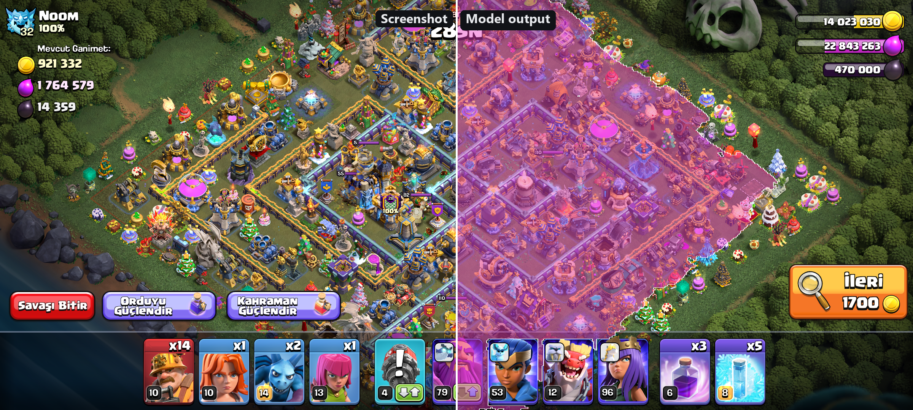
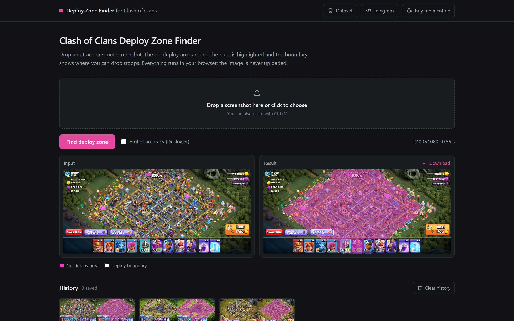
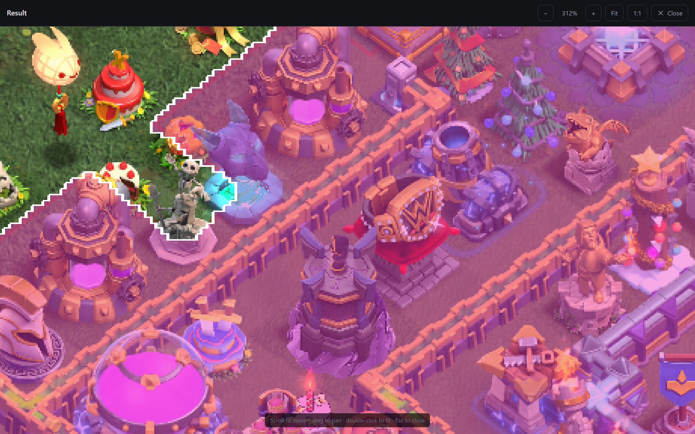
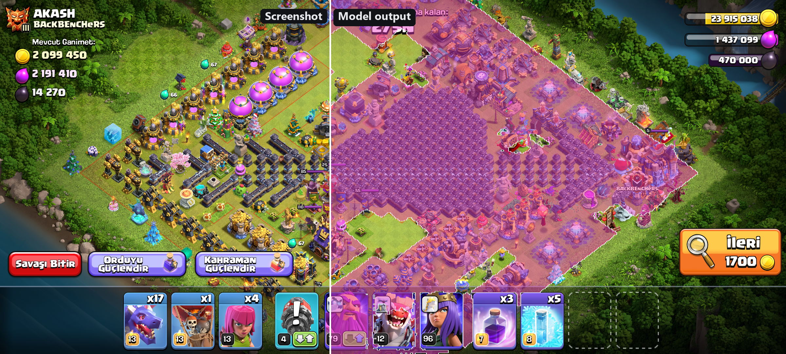
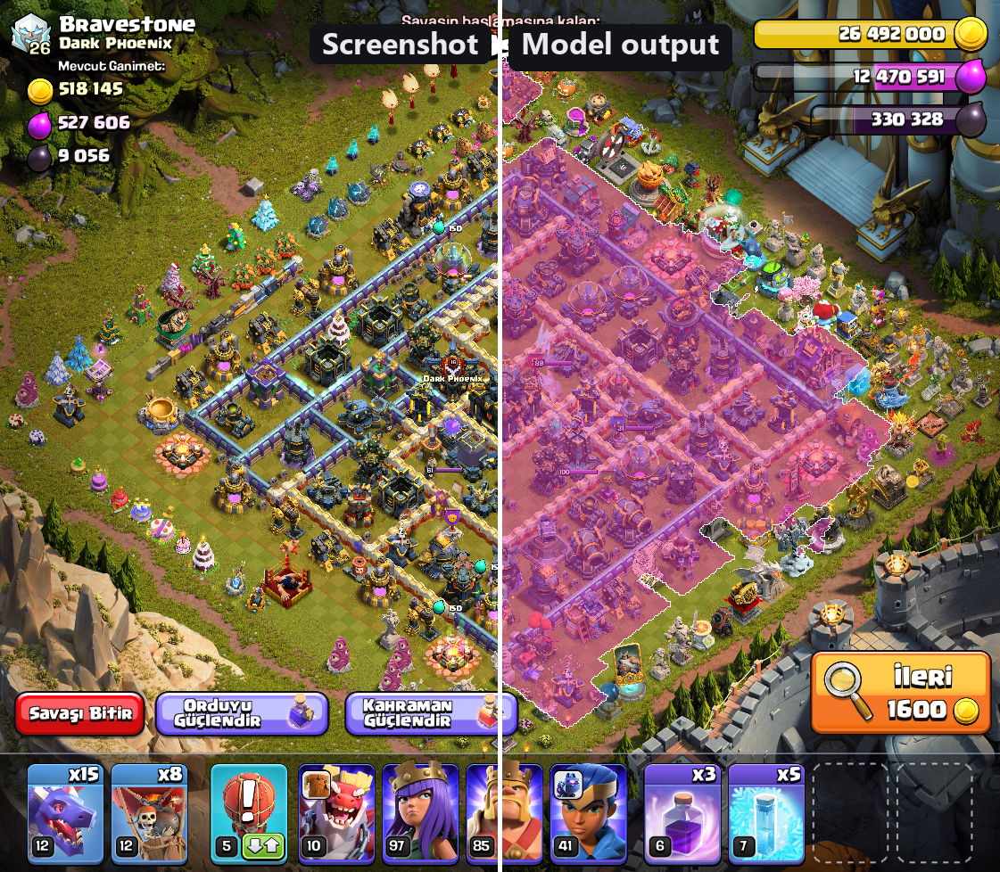
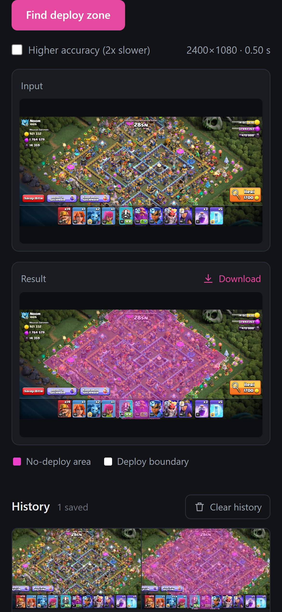
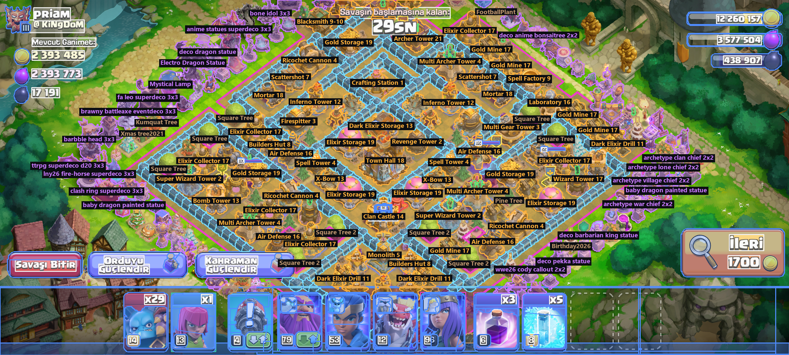
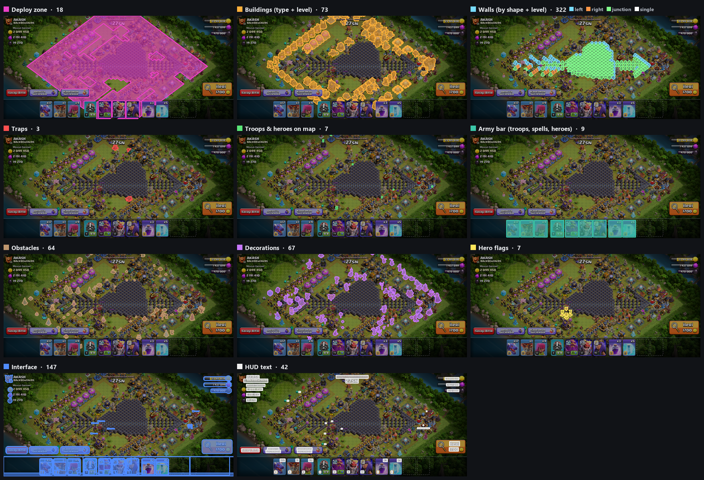
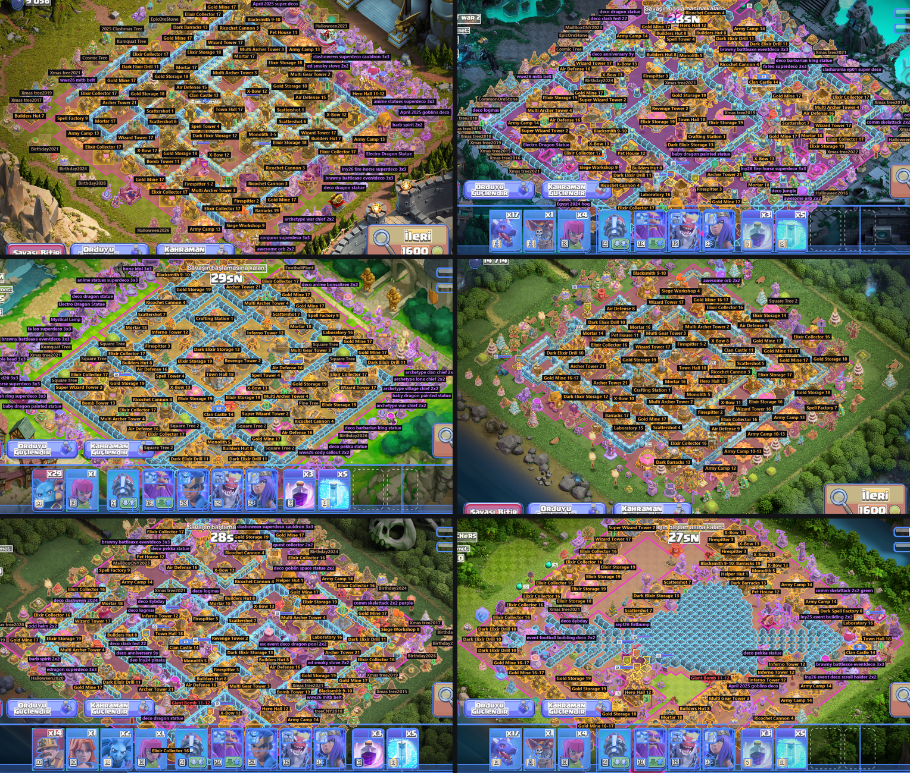

# Clash of Clans Vision

Two pieces of work built around Clash of Clans attack screens: a segmentation model that marks where troops can and
cannot be deployed, and the labelled screen dataset behind it.

- Live demo: [Deploy Zone Finder on Hugging Face](https://huggingface.co/spaces/nihatxp/coc-deploy-zone-finder)
- Free dataset sample: [clash-of-clans-screen-segmentation-sample](https://huggingface.co/datasets/nihatxp/clash-of-clans-screen-segmentation-sample)
- Browse the sample: [Dataset Viewer on Hugging Face](https://huggingface.co/spaces/nihatxp/coc-dataset-viewer)

## Deploy Zone Finder

When you scout a base, the game only lets you drop troops outside a border drawn around the village. On a busy base
with decorations, obstacles and the interface on top, that border is hard to read at a glance. The model takes a
screenshot and returns the no-deploy area as a mask, with the boundary traced on top.

It runs entirely in the browser. The full model is exported to ONNX and executed with ONNX Runtime Web, on the GPU
through WebGPU where the browser supports it and on the CPU (WebAssembly) otherwise, so there is no server and the
screenshot never leaves the device. A 2400×1080 screenshot takes about 1 second with WebGPU (the first run is slower
while the GPU warms up) and about 3.5 seconds on the CPU, measured on my desktop.

Some details:

- Results open in a viewer with wheel and pinch zoom, panning and 1:1 view, so the boundary can be checked tile by
  tile.
- Every run is kept in a local history (IndexedDB) on the visitor's own device and can be cleared at any time.
- It works with both full-width screenshots and the split-screen layout, and on phones.

The boundary follows the game's tile grid, including the gaps where deployment is allowed inside the border:

  
  

### Models

| | Light | Full (used on the site) |
|---|---|---|
| Architecture | U-Net, MobileNetV2 encoder | U-Net, EfficientNet-B4 encoder |
| Output | no-deploy area | no-deploy area + interface |
| Training screens | 4,674 | 8,824 |
| IoU, no-deploy area (1,458 validation screens) | 0.987 | 0.996 |
| Size | 27 MB | 78 MB |
| Speed | 0.5 s in the browser (CPU), 17 ms on GPU at 640×640 | about 1 s in the browser with WebGPU, 3.5 s on the CPU |

The light model runs at 640 px on the long side; the full one at 1280 px. On split-screen frames alone the light model
scores 0.992.

## Screen dataset

The model came out of a larger labelling effort: every object on an attack screen, segmented by its visible pixels.

| | |
|---|---|
| Frames | 9,000+ (growing every day) |
| Classes | 1,400+ |
| Objects per frame | about 760 |
| Layouts | 2400×1080 and split-screen 1121×978 |
| Formats | YOLO segmentation and COCO |

What is labelled:

- Buildings with type and level (`building/Inferno Tower/12`)
- Walls by shape and level: left, right, junction, single (`building/Wall/junction/18`)
- Traps, obstacles and decorations, including seasonal and event ones
- Troops and heroes on the map, and hero placement flags
- The army bar: each troop, spell and hero slot with count and level
- Interface elements and HUD text by meaning (enemy name, clan, available loot, own resources)
- The deploy zone itself

Each mask covers only the pixels
that are actually visible, so an object behind another object or behind the interface is cut accordingly, and the same
asset always gets the same class name.

A six-frame sample with images, YOLO labels, COCO annotations and the full class list is
[on Hugging Face](https://huggingface.co/datasets/nihatxp/clash-of-clans-screen-segmentation-sample), and every
label can be browsed in the [Dataset Viewer](https://huggingface.co/spaces/nihatxp/coc-dataset-viewer). The full
dataset is available on request.

## Stack

Python, PyTorch, segmentation_models_pytorch, ONNX, ONNX Runtime Web, IndexedDB, Pillow,
Hugging Face Spaces and Datasets.

## Contact

Telegram: [@nihatxp](https://t.me/nihatxp) · [Buy me a coffee](https://buymeacoffee.com/nihat)

---

Not affiliated with, endorsed, sponsored or approved by Supercell. Clash of Clans is a trademark of Supercell Oy.
