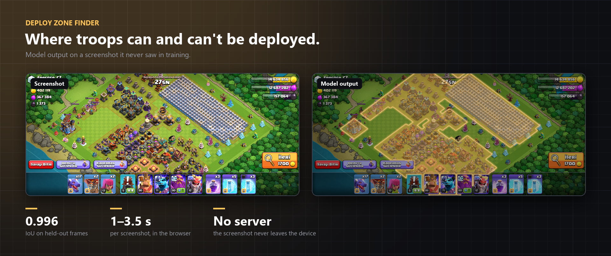
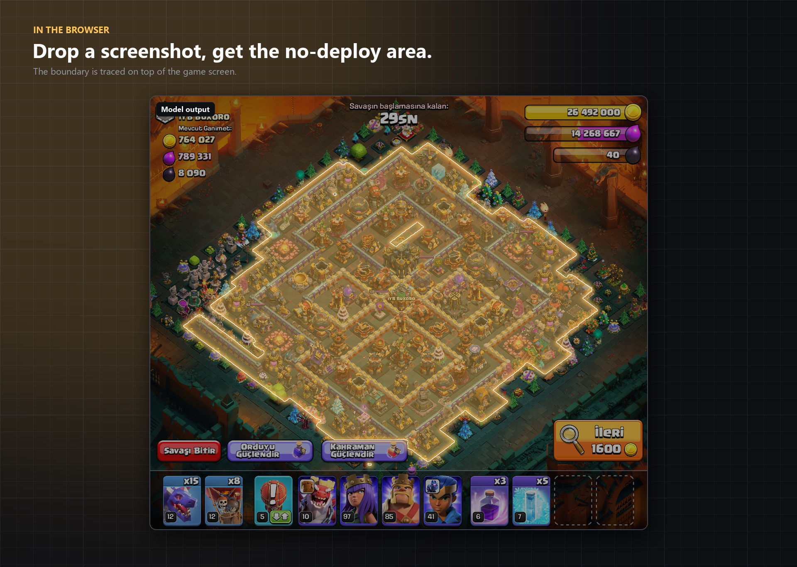
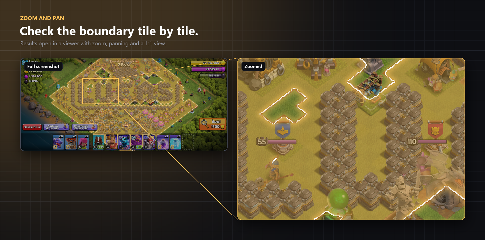
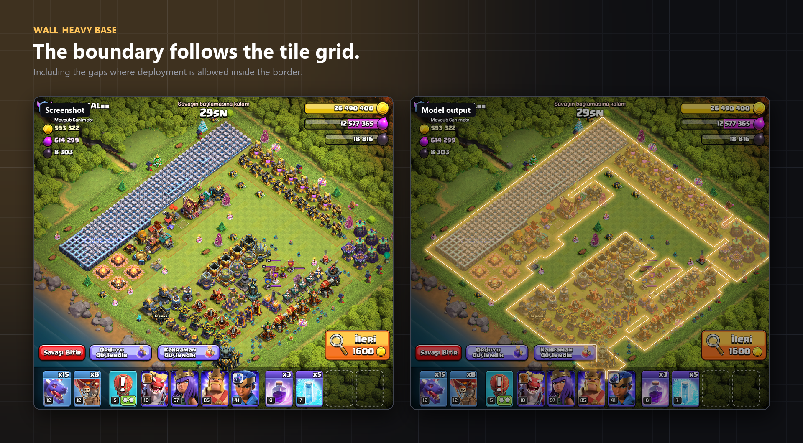
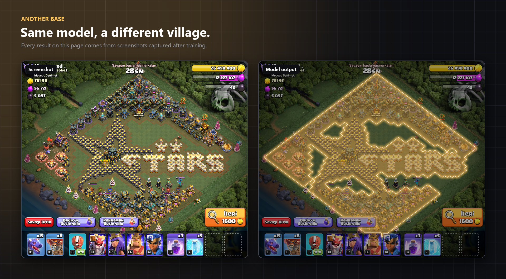
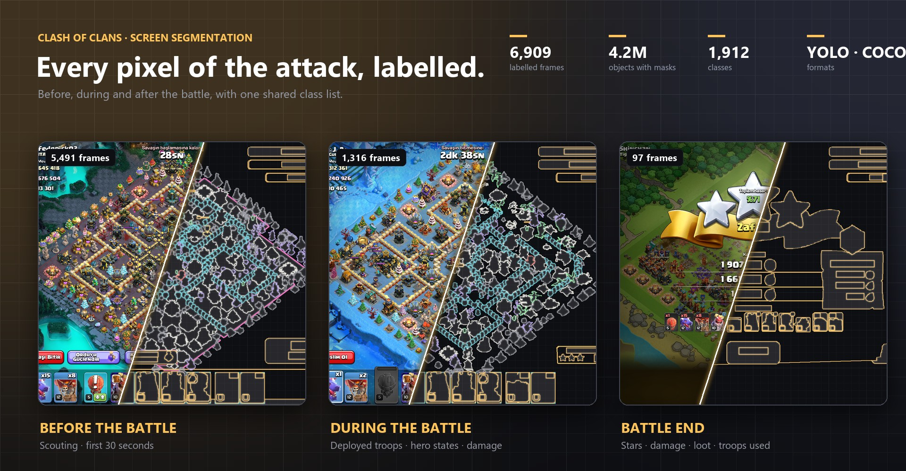
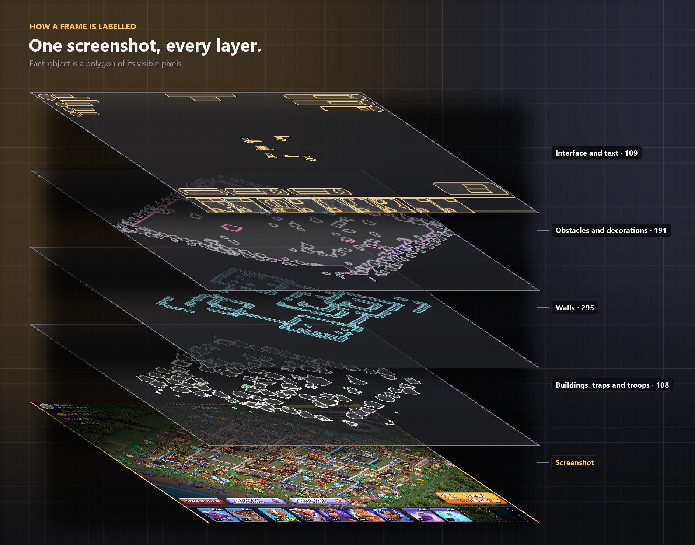
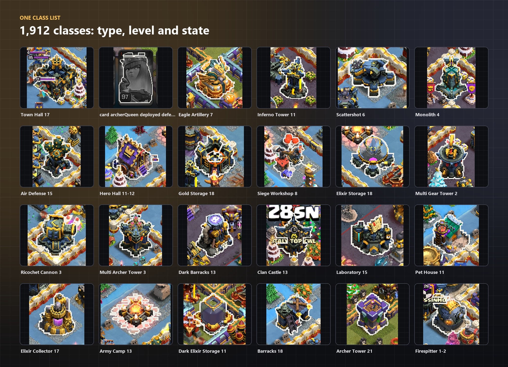

# Clash of Clans Vision

Two pieces of work built around Clash of Clans attack screens: a segmentation model that marks where troops can and
cannot be deployed, and the labelled screen dataset behind it.

- Live demo: [Deploy Zone Finder on Hugging Face](https://huggingface.co/spaces/nihatxp/coc-deploy-zone-finder)
- Free dataset sample: [clash-of-clans-screen-segmentation-sample](https://huggingface.co/datasets/nihatxp/clash-of-clans-screen-segmentation-sample)
- Browse the sample: [Dataset Viewer on Hugging Face](https://huggingface.co/spaces/nihatxp/coc-dataset-viewer)

## Deploy Zone Finder

When you scout a base, the game only lets you drop troops outside a border drawn around the village. On a busy base
with decorations, obstacles and the interface on top, that border is hard to read at a glance. The model takes a
screenshot and returns the no-deploy area as a mask, with the boundary traced on top.

A 2400×1080 screenshot is processed in about 1 to 3.5 seconds.

The boundary follows the game's tile grid, including the gaps where deployment is allowed inside the border:

  

### Models

| | Light | Full (used on the site) |
|---|---|---|
| Architecture | U-Net, MobileNetV2 encoder | U-Net, EfficientNet-B4 encoder |
| Output | no-deploy area | no-deploy area + interface |
| Training screens | 4,674 | 8,824 |
| IoU, no-deploy area (1,458 validation screens) | 0.987 | 0.996 |
| Size | 27 MB | 78 MB |
| Speed, 2400×1080 screenshot | about 0.5 s | 1–3.5 s |

The light model runs at 640 px on the long side; the full one at 1280 px.

## Screen dataset

The model came out of a larger labelling effort: every object on an attack screen, segmented by its visible pixels,
in three scenes: the first 30 seconds before the battle, the battle itself and the result screen.

| | |
|---|---|
| Frames | 6,900+ (growing every day) |
| Scenes | before, during and after the battle |
| Classes | 1,900+ |
| Objects per frame | about 600 |
| Screen sizes | 2400×1080 and 1121×978 |
| Formats | YOLO segmentation and COCO |

What is labelled:

- Buildings with type and level (`building/Inferno Tower/12`)
- Walls by shape and level: left, right, junction, single (`building/Wall/junction/18`)
- Traps, obstacles and decorations, including seasonal and event ones
- Troops and heroes on the map, and hero placement flags
- The army bar: each troop, spell and hero slot with count and level
- Interface elements and HUD text by meaning (enemy name, clan, available loot, own resources)
- The deploy zone itself
- During the battle: deployed troops, revealed traps, destroyed buildings, hero and siege machine cards with their
  state, the destruction percentage and the stars
- At the battle end: the result window with stars, total damage, loot and the troops used

Each mask covers only the pixels
that are actually visible, so an object behind another object or behind the interface is cut accordingly, and the same
asset always gets the same class name.

A nine-frame sample, three frames each from before, during and after the battle, with images, YOLO labels, COCO annotations and the full class list is
[on Hugging Face](https://huggingface.co/datasets/nihatxp/clash-of-clans-screen-segmentation-sample), and every
label can be browsed in the [Dataset Viewer](https://huggingface.co/spaces/nihatxp/coc-dataset-viewer). The full
dataset is available on request.

## Contact

Telegram: [@nihatxp](https://t.me/nihatxp) · [Buy me a coffee](https://buymeacoffee.com/nihat)

---

Not affiliated with, endorsed, sponsored or approved by Supercell. Clash of Clans is a trademark of Supercell Oy.
